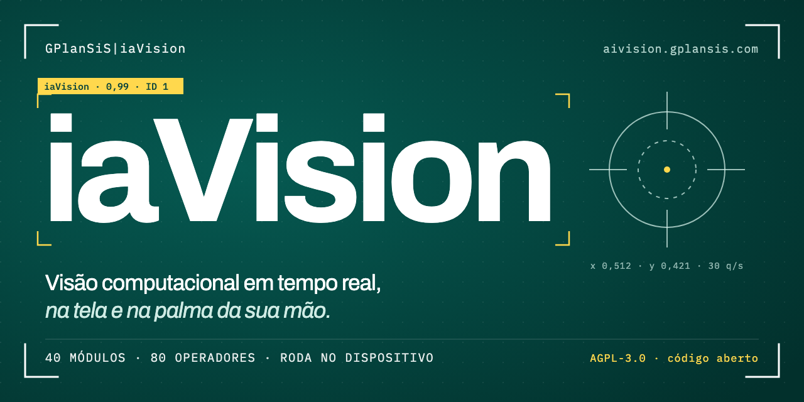
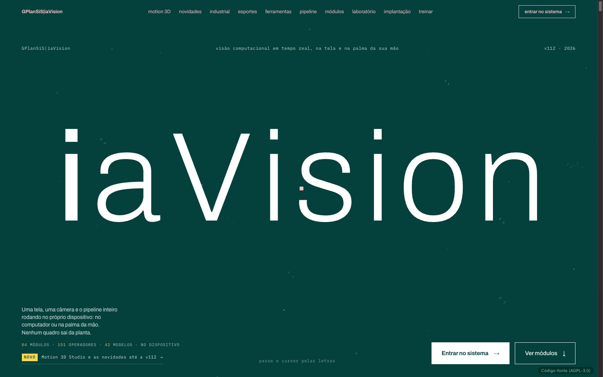
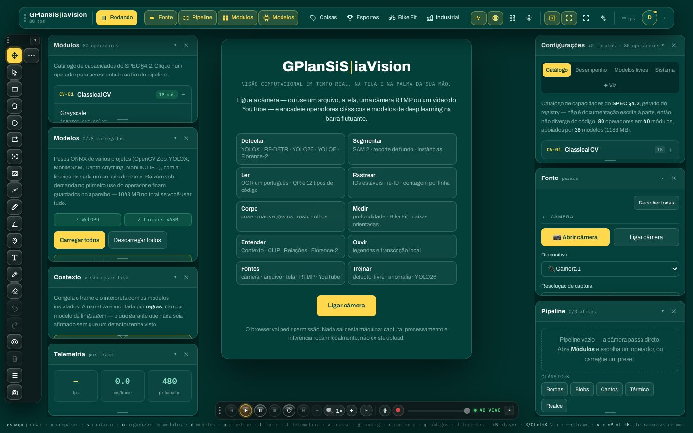
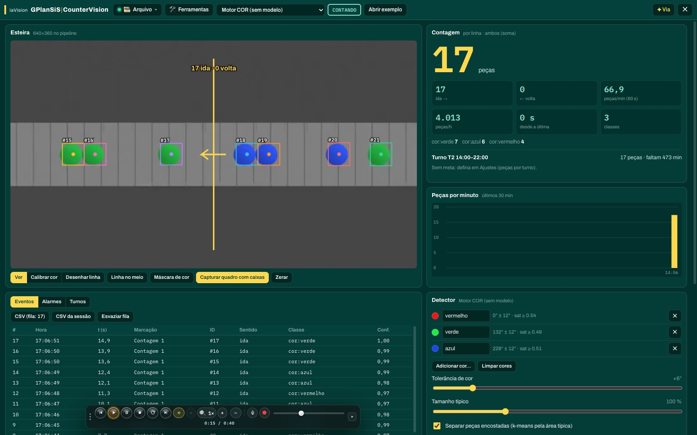
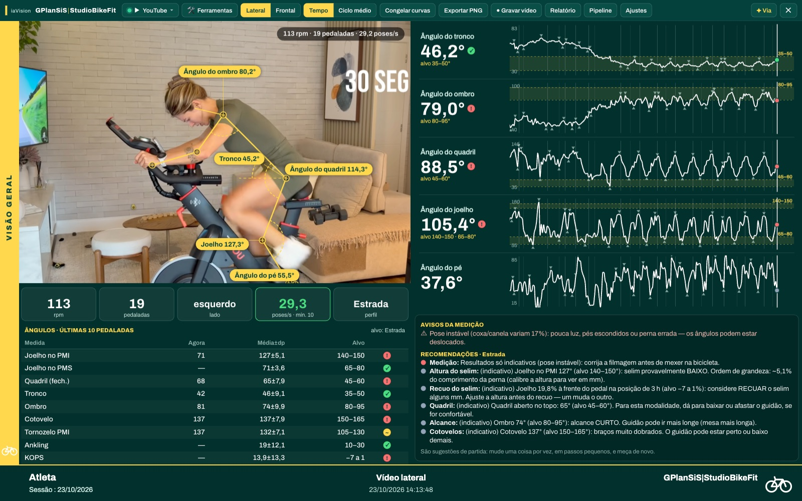
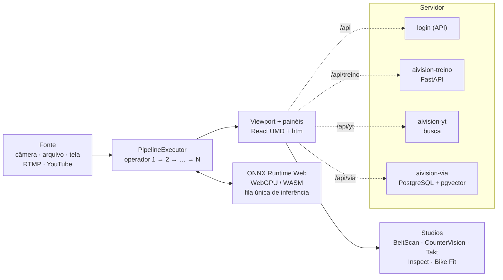

<p align="center">
  <a href="https://aivision.gplansis.com"></a>
</p>

<p align="center">
  <a href="LICENSE"></a>
  <a href="https://aivision.gplansis.com"></a>
  <a href="CHANGELOG.md"></a>
  <a href="CONTRIBUTING.md"></a>
</p>

<h3 align="center">
  <a href="https://aivision.gplansis.com">▶ Experimente no ar: aivision.gplansis.com</a>
</h3>

<p align="center">
  <a href="#o-que-é">O que é</a> ·
  <a href="#destaques">Destaques</a> ·
  <a href="#telas">Telas</a> ·
  <a href="#arquitetura">Arquitetura</a> ·
  <a href="#como-rodar-localmente">Rodar localmente</a> ·
  <a href="#contribua"><b>Contribua</b></a> ·
  <a href="docs/README.md">Documentação</a>
</p>

---

## O que é

O **GPlanSiS|iaVision** é uma plataforma de **visão computacional em tempo real que roda inteira no navegador**, no computador ou no celular. Uma câmera (ou um arquivo, a tela, uma câmera RTMP/IP ou um vídeo do YouTube) entra num **pipeline de operadores encadeáveis**: do processamento clássico (Canny, limiar, morfologia) aos modelos de deep learning (detecção, segmentação, pose, OCR, vocabulário aberto, profundidade), com **Studios** em tela cheia para a indústria e para o esporte.

- **84 módulos, 151 operadores, 38 modelos**, com o catálogo gerado do código em [docs/modulos.md](docs/modulos.md).
- **Tudo no dispositivo:** os modelos rodam com ONNX Runtime Web, na placa de vídeo (WebGPU) quando o aparelho permite e em WASM com threads nos demais. Nenhum quadro de vídeo vai para o servidor durante a análise.
- **Sem build:** ES modules servidos como estão, React UMD + htm. Clonou, baixou os `.wasm`, rodou.
- **Código aberto** sob AGPL-3.0, em português.

## Destaques

### Industrial

| Studio | O que faz |
|---|---|
| **BeltScan** | Volumetria de correia transportadora por triangulação laser–câmera: seção do material, vazão em m³/h, massa em t/h e nível, com alarmes no padrão ISA-18.2. |
| **CounterVision** | Contagem de peças em esteira com motor de cor sem modelo (ou um detector ONNX), linhas e zonas com sentido, peças/min, turnos, metas e CSV. |
| **Takt** | Tempo de posto pela pose: ciclos, ocupação e Gantt do turno, com rostos borrados. |
| **Inspect** | Inspeção visual OK / NOK / INCERTO: presença, paquímetro em mm, cor ΔE2000, forma, OCR de lote e validade, códigos GS1, anomalia PatchCore e Cpk. |

Detalhes em [docs/industrial.md](docs/industrial.md).

### Esportes e biomecânica

**Studio Bike Fit** (ângulos por pedalada, KOPS, faixas por modalidade, relatório em CSV, JSON e PDF, protótipo 3D com várias câmeras) e mais 7 módulos: **Ergonomia** RULA/REBA, **Academia** (repetições e forma), **Salto** (CMJ, RSI), **Corrida** com várias pessoas, **Swing** (golfe e raquete), **VBT** (velocidade da barra) e **Quadra** (jogadores, radar, mapa de calor). Ver [docs/esportes.md](docs/esportes.md).

### Ferramentas

- **Via:** assistente de IA (Claude, com a chave do próprio usuário) que monta cadeias, olha o quadro atual e consulta uma base de conhecimento. [docs/via.md](docs/via.md)
- **Ferramentas de mouse:** régua e ângulo calibrados, zonas e linhas de contagem, ROI e exclusão, marcações sobre o vídeo.
- **+Projeto:** rotulagem de imagens para treinar modelos próprios. [docs/projeto.md](docs/projeto.md)
- **GPlanSiS|Vídeo:** editor com quadro exato, cortes, recorte/Ken Burns e exportação MP4 no navegador (WebCodecs). [docs/video.md](docs/video.md)
- **Treinar:** treino de RF-DETR, PatchCore e YOLO26 com fila e comparação. [docs/treinar.md](docs/treinar.md)

### Fontes

Câmera do aparelho, câmeras USB e Continuidade, câmeras Wi-Fi/IP (WHEP), arquivo de imagem ou vídeo, compartilhamento de tela, RTMP e **YouTube** com controles e teclas de mídia. [docs/fontes.md](docs/fontes.md)

### Plataforma

- **WebGPU por modelo**, com queda automática para WASM, fila única de inferência com prioridade e abertura sob demanda. [docs/desempenho.md](docs/desempenho.md)
- **Funciona no Safari** (macOS e iOS), no Chrome, no Edge e no Firefox, com os contornos documentados em [docs/compatibilidade.md](docs/compatibilidade.md).
- **PWA** com cache permanente dos pesos: o modelo baixa uma vez e fica no aparelho.

## Telas

| | |
|---|---|
| <br><sub>Página principal</sub> | <br><sub>O sistema: painéis, barra e Pipeline</sub> |
| <br><sub>Studio CounterVision com o vídeo de exemplo</sub> | <br><sub>Esportes: Studio Bike Fit e módulos de biomecânica (página principal)</sub> |

## Arquitetura

Site estático: o navegador faz a visão computacional; o servidor serve os arquivos e dá três apoios (login, treino de modelos e busca no YouTube), mais a memória opcional da Via.



Cada operador é um objeto declarativo (`op`, `label`, `params`, `apply(src, p, state, ctx)`) registrado em `site/js/cv/registry.js`; um nome fora do registro não executa. Detalhes em [docs/arquitetura.md](docs/arquitetura.md).

## Como rodar localmente

Requisitos: **Python 3.8+**, **curl** e um navegador recente. Não há `npm install` nem build.

```bash
git clone https://github.com/SSBianchiplan/aivision.git
cd aivision
ferramentas/baixar-wasm.sh        # baixa os .wasm do ONNX Runtime Web (fora do git por tamanho)
python3 ferramentas/servir.py     # abre em http://localhost:8800
```

1. **Servidor com COOP/COEP.** O ONNX Runtime precisa de `crossOriginIsolated` para usar threads, então a página exige `Cross-Origin-Opener-Policy: same-origin` e `Cross-Origin-Embedder-Policy: require-corp`. O [`ferramentas/servir.py`](ferramentas/servir.py) (só biblioteca padrão) manda esses cabeçalhos, acerta o MIME de `.mjs`/`.wasm` e desliga o cache. Um `python -m http.server` comum **não** serve.
2. **Binários do ONNX Runtime Web.** O [`ferramentas/baixar-wasm.sh`](ferramentas/baixar-wasm.sh) baixa do jsDelivr as versões exatas que o código usa: `onnxruntime-web@1.20.1` → `ort-wasm-simd-threaded.wasm` (11 MB) e `ort-wasm-simd-threaded.jsep.wasm` (21 MB, WebGPU) em `site/vendor/ort/`; `onnxruntime-web@1.29.0` → `ort-wasm-simd-threaded.jsep.wasm` em `site/relacoes/vendor/ort/` (página Relações).
3. **Pesos dos modelos.** Não estão no git (≈1,4 GB). O app baixa cada um de `models/...` ou `relacoes/models/...` quando o operador é usado; o caminho, o tamanho, a licença e a origem estão em cada spec de `site/js/cv/runtime/onnx.js` e `models-livres-*.js`. Para testar um modelo localmente, baixe-o do sistema no ar:
   ```bash
   curl --create-dirs -o site/models/yolox.onnx https://aivision.gplansis.com/models/yolox.onnx
   ```
   Os operadores clássicos, o CounterVision por cor e o Inspect sem modelo rodam sem peso nenhum.
4. **Login local.** O sistema (`/app.html`) consulta `api/me`. Sem a API, crie `site/api/me` (ignorado pelo git) com `{"authenticated": true, "challenge_required": false, "csrf": "x", "user": {"id": 1, "name": "Dev", "email": "dev@exemplo.local", "scopes": []}}`.

Pronto: abra `http://localhost:8800/app.html`, vá em **Industrial › Abrir Studio CounterVision › Abrir exemplo** e veja a contagem rodando com o vídeo de exemplo. Os serviços (`servicos/`) têm `Dockerfile`, `docker-compose.yml` e `LEIA-ME.md` próprios. Mais em [CONTRIBUTING.md](CONTRIBUTING.md#montar-o-ambiente) e [docs/deploy-e-testes.md](docs/deploy-e-testes.md).

## Estrutura

```text
aivision/
├── site/                     # o site publicado (servido como está, sem build)
│   ├── index.html            # página principal
│   ├── app.html              # o sistema
│   ├── sw.js                 # service worker (VERSION = versão publicada)
│   ├── js/
│   │   ├── app.js            # login (carga mínima)
│   │   ├── workspace.js      # o sistema, importado depois do login
│   │   ├── cv/               # núcleo de visão: registry, executor, core
│   │   │   ├── operators/    # os operadores (livres-a … livres-n por grupo)
│   │   │   └── runtime/      # ONNX Runtime, catálogo de modelos, fila de inferência
│   │   ├── components/       # painéis; industrial/ e esportes/ com os Studios
│   │   ├── via/              # assistente Via
│   │   ├── projeto/          # +Projeto (rotulagem)
│   │   └── youtube/, camera/, state/, layout/, auth/
│   ├── css/                  # estilos por área
│   ├── vendor/               # React, htm, ONNX Runtime (.js), hls.js, ZXing, SDK Anthropic…
│   ├── treino/               # página Treinar
│   ├── relacoes/             # página Relações (grafo de cena)
│   ├── yt/                   # player do YouTube sem isolamento (Safari/Firefox)
│   └── amostras/             # vídeo de exemplo do CounterVision
├── servicos/
│   ├── treino/               # FastAPI: RF-DETR, PatchCore, YOLO26
│   ├── youtube/              # busca do YouTube (só metadados)
│   └── via/                  # memória e base de conhecimento da Via (PostgreSQL + pgvector)
├── ferramentas/              # servir.py e baixar-wasm.sh
├── docs/                     # documentação técnica e roadmap
└── .github/                  # capa, telas, modelos de issue e de PR
```

## Contribua

**O iaVision está aberto para colaboradores.** Se você gosta de visão computacional, de web rápida, de biomecânica ou de chão de fábrica, tem lugar para você aqui. Não precisa ser especialista em deep learning: muita coisa útil é JavaScript puro sobre `ImageData`.

O que dá para fazer:

- **Operadores e Studios novos** a partir do [roadmap](docs/roadmap.md): cerca de 100 ideias com esforço estimado, como leitor de manômetro analógico, fotocélula virtual para sprint, frequência respiratória pelo movimento, contagem de insetos em armadilha, correção de gabarito e corte de cena automático no editor.
- **Presets prontos:** muitas ideias são só encadear operadores que já existem (esforço **P** no roadmap).
- **Testes em GPUs e celulares diferentes:** valide o WebGPU em placas Intel, AMD e NVIDIA, no Android e no iPhone, e relate o que encontrar. É a contribuição mais valiosa para quem não quer escrever código.
- **Traduções** da interface e das docs (inglês, espanhol).
- **Documentação:** guias por Studio, exemplos, correções.
- **Testes automatizados** dos operadores no navegador.

**Boas para começar:** as ideias marcadas com ✓ no [roadmap](docs/roadmap.md) e as issues com o rótulo `boa primeira issue`. Antes de algo grande, abra uma issue com o modelo **Ideia de módulo/operador** para combinarmos o desenho.

**Leia o [guia de contribuição](CONTRIBUTING.md)**, com ambiente, estilo de código, contrato do operador e fluxo de PR, e o [Código de Conduta](CODE_OF_CONDUCT.md). Falhas de segurança: [SECURITY.md](SECURITY.md).

## Documentação

Tudo em [`docs/`](docs/README.md): [arquitetura](docs/arquitetura.md) · [interface](docs/interface.md) · [fontes e YouTube](docs/fontes.md) · [catálogo de módulos](docs/modulos.md) · [Industrial](docs/industrial.md) · [esportes](docs/esportes.md) · [Bike Fit](docs/bike-fit.md) · [Bike Fit 3D](docs/bike-fit-3d.md) · [Via](docs/via.md) · [+Projeto](docs/projeto.md) · [editor de vídeo](docs/video.md) · [desempenho](docs/desempenho.md) · [Treinar](docs/treinar.md) · [serviços](docs/servicos.md) · [compatibilidade](docs/compatibilidade.md) · [deploy e testes](docs/deploy-e-testes.md) · [licenças](docs/licencas.md) · [roadmap](docs/roadmap.md) · [histórico](CHANGELOG.md).

## Licença e modelos de terceiros

O código do iaVision é distribuído sob a **[GNU AGPL-3.0](LICENSE)**. Quem roda uma versão modificada como serviço em rede precisa oferecer o código-fonte correspondente aos usuários; o sistema no ar oferece o seu em [/codigo-fonte/](https://aivision.gplansis.com/codigo-fonte/).

Os pesos dos modelos não estão no repositório e cada um mantém a licença de origem, registrada no spec e listada em [docs/licencas.md](docs/licencas.md):

- **AGPL-3.0:** Ultralytics **YOLO26**, **YOLOE** e os detectores treinados com YOLO26. Ficam desligados por padrão e só carregam após aceite explícito.
- **Apache-2.0:** **RF-DETR** (variantes nano e small), YOLOX, PP-OCR, MobileSAM, SAM 2.1, Depth Anything V2 small, RTMO, MediaPipe, entre outros.
- **MIT:** Florence-2, BiRefNet. **Apple ML:** MobileCLIP. **Licença Meta (DINOv3):** pesos do RelateAnything.

Antes de uso comercial, revise as licenças dos modelos que você habilitar.

## Créditos

Desenvolvido pela **GPlanSiS**, com modelos e bibliotecas de código aberto de muitas comunidades (veja [docs/licencas.md](docs/licencas.md)). Contato: **contato@gplansis.com**.

<p align="center"><sub>GPlanSiS|iaVision · visão computacional em tempo real, na tela e na palma da sua mão.</sub></p>
